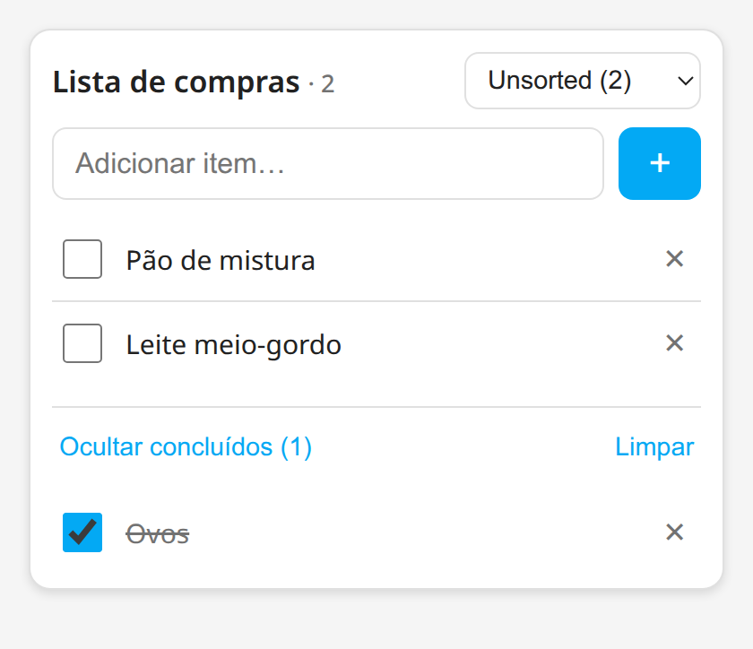
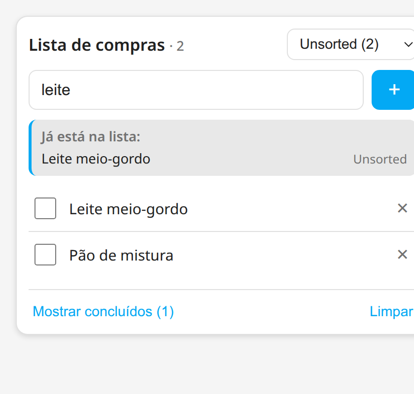
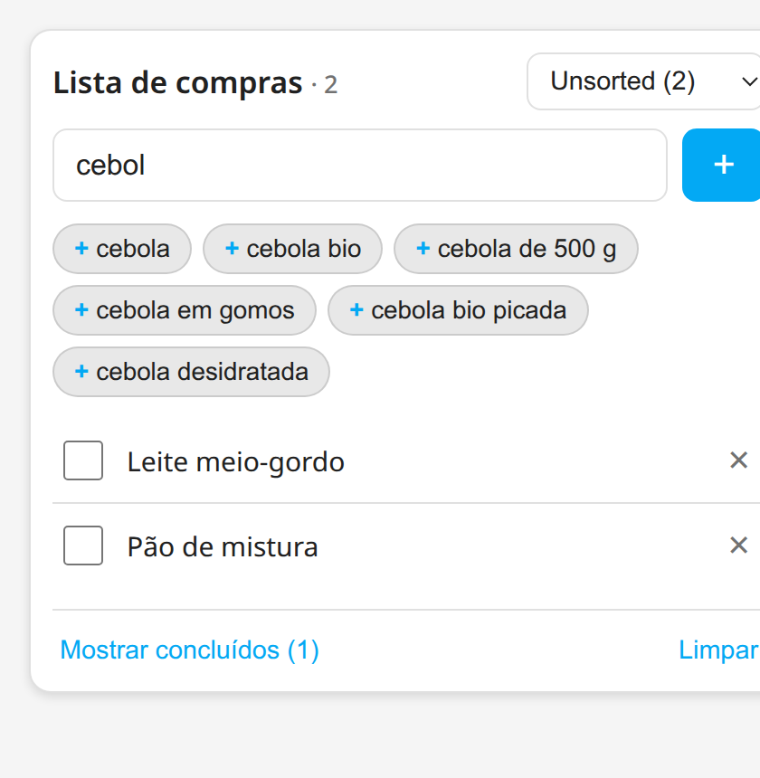

# Norish Shopping Card



Um cartão Lovelace para Home Assistant que faz uma lista de compras estilo
**Bring!**, alimentada pelo Norish através da integração
[hass-norish](https://github.com/Caps3n/hass-norish).

Só texto, sem imagens. O cartão **não fala com a API do Norish** — lê e escreve
as entidades to-do que a integração já expõe (uma por loja) e deixa a chave da
API onde está: no servidor.

📖 **Explicação detalhada de como funciona** (com demo ao vivo, sem Home Assistant):
[`docs/como-funciona.html`](docs/como-funciona.html)

## Funcionalidades



- **Seletor de loja** no cabeçalho: `Unsorted` + uma lista por loja
  (Lidl, Mercadona, Continente, Auchan, …), cada uma com a contagem de itens
  ativos.
- **Adicionar item** — escreve e prime Enter (ou o botão `+`).
- **Marcar / desmarcar feita** — checkbox; os itens feitos passam para uma
  secção recolhível.
- **Editar** — toca no texto do item, altera e prime Enter (Escape cancela).
- **Apagar item** — botão `✕`.
- **Limpar concluídos** — botão na barra inferior.
- **Aviso de duplicados** — enquanto escreves, o cartão mostra o que já está
  na lista (em qualquer loja) e, se configurares, o que já tens na despensa do
  Norish. É um aviso, não um bloqueio: podes sempre adicionar.
- Atualização em tempo real por subscrição websocket.

## Requisitos

- Home Assistant 2024.11 ou superior.
- A integração [hass-norish](https://github.com/Caps3n/hass-norish) instalada e
  a funcionar (é ela que cria as entidades `todo.norish_*`).

## Instalação (HACS)

1. HACS → canto superior direito (⋮) → **Custom repositories**.
2. URL: `https://github.com/jdrdionisio/norish-shopping-card`,
   categoria **Dashboard** (Lovelace).
3. Instala o **Norish Shopping Card**.
4. Se o recurso não for adicionado automaticamente, vai a
   **Definições → Dashboards → Recursos** e adiciona:

   ```
   URL: /hacsfiles/norish-shopping-card/norish-shopping-card.js
   Tipo: Módulo JavaScript
   ```

5. Recarrega o browser (Ctrl+Shift+R).

### Instalação manual

Copia `norish-shopping-card.js` para `config/www/` e regista o recurso
`/local/norish-shopping-card.js` (tipo Módulo JavaScript).

## Utilização

```yaml
type: custom:norish-shopping-card
title: Lista de compras
```

O cartão descobre sozinho todas as entidades `todo.norish_*`. Para fixar as
listas e a ordem:

```yaml
type: custom:norish-shopping-card
title: Compras da semana
entities:
  - todo.norish_unsorted
  - todo.norish_mercadona
  - todo.norish_continente
```

### Opções

| Opção      | Tipo            | Por omissão          | Descrição |
|------------|-----------------|----------------------|-----------|
| `title`    | string          | `Lista de compras`   | Título do cartão. |
| `entities` | lista de ids    | (auto-descoberta)    | Lista explícita de entidades `todo.norish_*` e respetiva ordem. |
| `warn_duplicates` | bool     | `true`               | Avisar quando o texto escrito já corresponde a um item da lista. |
| `pantry_entity`   | entity id | (nenhuma)           | Sensor com a despensa do Norish; liga o aviso «já tens em casa». Ver `docs/pantry-opcional.yaml`. |
| `ingredients_url` | URL      | (nenhuma)            | Ficheiro JSON com o catálogo de alimentos, servido pelo HA (ex. `/local/norish-ingredients.json`); liga as sugestões ao escrever. |
| `ingredients`     | lista    | (nenhuma)            | O mesmo catálogo, mas escrito no YAML — para listas curtas. |

## Evitar criar itens duplicados

O cartão faz duas verificações enquanto escreves, por baixo do campo de
adicionar:

1. **Contra a lista atual** (sempre ativa). Percorre os itens de *todas* as
   lojas, não só da visível — um item noutra loja continua a ser um item que já
   está na lista. Distingue os que estão por comprar dos já comprados.
2. **Contra a despensa** (opcional). A despensa é a secção «o que temos em
   casa» do Norish, e é a forma de evitar comprar o que já existe no armário.

A comparação normaliza o texto antes de o comparar: ignora maiúsculas e
acentos, descarta a quantidade e a unidade do início (`2 kg batatas` e
`batatas` são a mesma coisa), e tolera singular/plural (`ovo` encontra `Ovos`).
Nomes inventados não dão falso positivo — `leitinho` não corresponde a `Leite
meio-gordo`.

Como a despensa não está exposta ao Home Assistant, o ponto 2 precisa de um
sensor REST no teu `configuration.yaml`. Fica tudo explicado, com o YAML e o
URL já testados, em [`docs/pantry-opcional.yaml`](docs/pantry-opcional.yaml).

> Porque não vai buscar isto diretamente ao Norish: a API do Norish não envia
> cabeçalhos CORS (um pedido `OPTIONS` com origem do HA responde `204` sem
> nenhum `Access-Control-*`), e a chave da API teria de ficar visível no
> JavaScript do cartão. Os dados têm de entrar pelo servidor.

## Sugestões de alimentos (o catálogo do Norish)



Ao escrever, além dos avisos, o cartão mostra os alimentos que o Norish conhece
a começar por aquele texto — e **tocar num deles adiciona-o**. Não é preciso
acertar no nome exato, e nada é bloqueado: o campo continua a aceitar qualquer
texto novo.

O catálogo é a lista de alimentos que o Norish usa para reconhecer o que se
escreve (a taxonomia do Open Food Facts, com os nomes em português). Ele não
está exposto ao Home Assistant, por isso tem de ser materializado num ficheiro
que o HA sirva **na mesma origem** — e aí o cartão lê-o sem CORS e sem chave.

### Como obter o ficheiro

**Se já tens um export do Norish** (`{source, ingredients:[…]}`, com os aliases
em várias línguas), converte-o:

```bash
scripts/norish-catalogue-dump.py \
  --from-export norish-ingredients-2026-11-07.json \
  --out norish-ingredients.json
```

Um export real de 6214 alimentos com 71 516 aliases passou de **5,4 MB para
202 KB** (10 126 nomes), descartando as outras línguas e as descrições de
preparação («alho descascado e cortado em rodelas finas»), que não são coisas
que se compram.

**Se não tens export**, o mesmo script vai buscá-lo à API (retomável, e respeita
o limite de 500 pedidos/hora da chave — pára e continua mais tarde):

```bash
scripts/norish-catalogue-dump.py --status          # quanto falta?
scripts/norish-catalogue-dump.py --max-calls 400   # uma passagem
```

### Como instalar

```bash
cp norish-ingredients.json /config/www/
```

e no cartão:

```yaml
type: custom:norish-shopping-card
title: Lista de compras
ingredients_url: /local/norish-ingredients.json
```

`/local/` é a pasta `config/www` do Home Assistant, servida na mesma origem do
dashboard. Para listas curtas, podes escrever o catálogo no próprio YAML com
`ingredients: ["cebola", "alho", …]`.

### Formatos aceites

O cartão aceita qualquer destas formas, sem configuração:

```json
["cebola", "alho", "manteiga"]
```
```json
[{"name": "onion", "localeNames": {"pt": "cebola"}}]
```
```json
{"source": "…", "ingredients": [{"name": "onion", "aliases": [{"text": "cebola", "locale": "pt"}]}]}
```

Dos objetos usa o nome português, o inglês e os aliases em português, inglês ou
sem língua indicada.

> **Nota de licença:** o catálogo vem da taxonomia de ingredientes do Open Food
> Facts, distribuída sob **ODbL**. Por isso é que ele **não** vive neste
> repositório: é gerado localmente e fica do lado do Home Assistant. Se o
> redistribuíres, mantém a atribuição e a licença.

## Notas

- Criar ou gerir **lojas** não é possível a partir do cartão: as lojas são
  geridas na app Norish e a integração apenas as descobre. O cartão faz CRUD de
  **itens**.
- O Norish reescreve o texto do item ao gravar (quantidade/unidade são
  interpretadas pelo servidor), por isso um item pode aparecer ligeiramente
  diferente depois de gravado — por exemplo `2 kg farinha`.
- Reordenar arrastando não está disponível: a entidade to-do do Norish não
  expõe essa capacidade.

## Desenvolvimento

A imagem do README é gerada a partir de `docs/preview.html`, que carrega o
cartão com um `hass` simulado:

```
cd docs
google-chrome --headless=new --window-size=420,362 --force-device-scale-factor=2 \
  --screenshot=card.png "file://$PWD/preview.html"
```

## Licença

MIT — ver [LICENSE](LICENSE).
