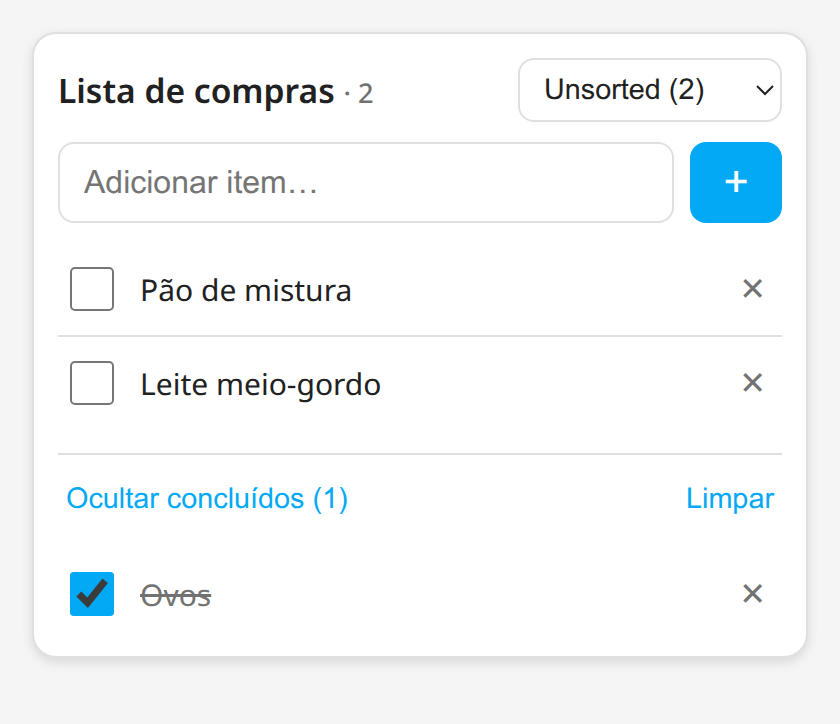
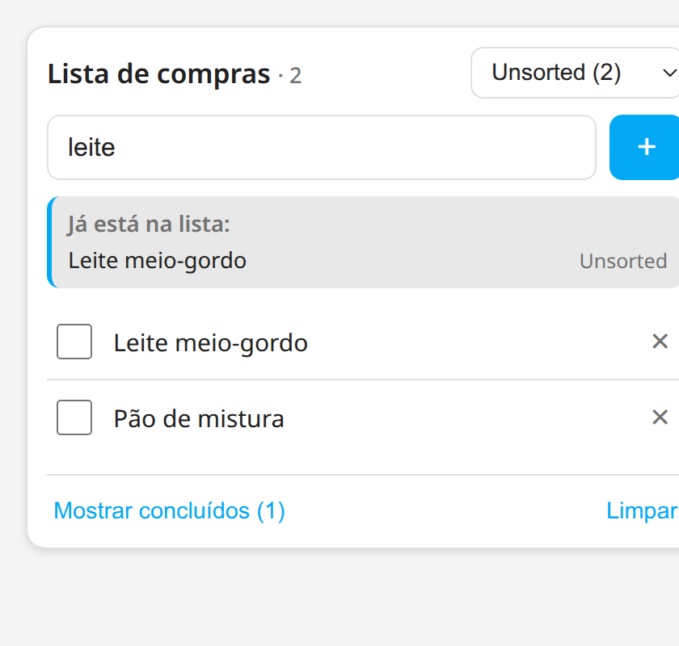
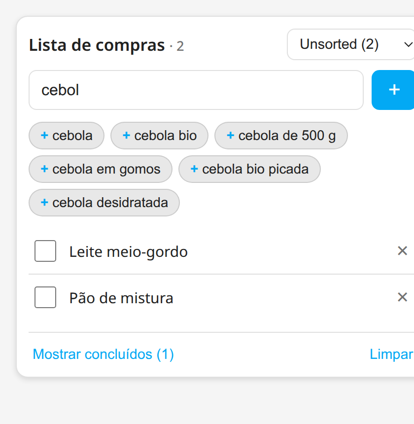

# Norish Shopping Card

🌍 **English** · [Português](README.pt.md)



A Lovelace card for Home Assistant that gives you a **Bring!**-style shopping
list, backed by Norish through the
[hass-norish](https://github.com/Caps3n/hass-norish) integration.

Text only, no images. The card **does not talk to the Norish API** — it reads and
writes the to-do entities the integration already exposes (one per store) and
leaves the API key where it belongs: on the server.

📖 **A detailed walkthrough of how it works** (in Portuguese, with a live demo and
no Home Assistant required): [`docs/como-funciona.html`](docs/como-funciona.html)

## Features



- **Store selector** in the header: `Unsorted` plus one list per store
  (Lidl, Mercadona, Continente, Auchan, …), each with its count of active items.
- **Add an item** — type and press Enter (or tap `+`).
- **Tick / untick as done** — checkbox; completed items move to a collapsible
  section.
- **Edit** — tap the item text, change it, press Enter (Escape cancels).
- **Delete an item** — the `✕` button.
- **Clear completed** — button in the bottom bar.
- **Duplicate warning** — as you type, the card shows what is already on the
  list (in any store) and, if configured, what you already have in the Norish
  pantry. It warns, it does not block: you can always add the item.
- Live updates over a websocket subscription.
- **Optional events** (`fire_events`) for automations — see
  [Automations](#automations-suggestions).

## Requirements

- Home Assistant 2024.11 or later.
- The [hass-norish](https://github.com/Caps3n/hass-norish) integration installed
  and working (it creates the `todo.norish_*` entities).

## Installation (HACS)

1. HACS → top-right menu (⋮) → **Custom repositories**.
2. URL: `https://github.com/jdrdionisio/norish-shopping-card`,
   category **Dashboard** (Lovelace).
3. Install **Norish Shopping Card**.
4. If the resource is not added automatically, go to
   **Settings → Dashboards → Resources** and add:

   ```
   URL: /hacsfiles/norish-shopping-card/norish-shopping-card.js
   Type: JavaScript module
   ```

5. Reload the browser (Ctrl+Shift+R).

### Manual installation

Copy `norish-shopping-card.js` into `config/www/` and register the resource
`/local/norish-shopping-card.js` (type: JavaScript module).

## Usage

```yaml
type: custom:norish-shopping-card
title: Shopping list
```

The card discovers every `todo.norish_*` entity by itself. To pin the lists and
their order:

```yaml
type: custom:norish-shopping-card
title: This week's shopping
entities:
  - todo.norish_unsorted
  - todo.norish_mercadona
  - todo.norish_continente
```

### Options

| Option      | Type            | Default              | Description |
|-------------|-----------------|----------------------|-------------|
| `title`    | string          | `Lista de compras`   | Card title. |
| `entities` | list of ids     | (auto-discovered)    | Explicit list of `todo.norish_*` entities and their order. |
| `warn_duplicates` | bool     | `true`               | Warn when the text you typed already matches an item on the list. |
| `pantry_entity`   | entity id | (none)              | Sensor holding the Norish pantry; enables the “you already have this at home” warning. See `docs/pantry-opcional.yaml`. |
| `ingredients_url` | URL      | (auto-discovered)    | JSON file with the food catalogue. If you leave it out, the card looks for one itself (see below). |
| `ingredients`     | list     | (none)               | The same catalogue, written inline in YAML — handy for short lists. |
| `suggestions`     | number   | `10`                 | How many suggestions to show (1 to 30). |
| `fire_events`     | bool     | `false`              | Announce every action as a Home Assistant event, including who did it — for “who added what” automations. See [Automations](#automations-suggestions). |

## Avoiding duplicate items

While you type, the card runs two checks just below the add field:

1. **Against the current list** (always on). It walks the items of *every* store,
   not just the visible one — an item filed under another store is still an item
   that is already on the list. Items still to buy are shown separately from ones
   already bought.
2. **Against the pantry** (optional). The pantry is Norish's “what we have at
   home” section, and it is how you avoid buying what is already in the cupboard.

The comparison normalises the text first: it ignores case and accents, drops a
leading quantity and unit (`2 kg potatoes` and `potatoes` are the same thing),
and tolerates singular/plural (`egg` finds `Eggs`). Invented names do not
produce false positives — `milky` does not match `Semi-skimmed milk`.

Because the pantry is not exposed to Home Assistant, check 2 needs a REST sensor
in your `configuration.yaml`. It is all documented, with the YAML and the URL
already tested, in [`docs/pantry-opcional.yaml`](docs/pantry-opcional.yaml).

> Why not fetch this straight from Norish: the Norish API sends no CORS headers
> (an `OPTIONS` request from the HA origin answers `204` with no
> `Access-Control-*` at all), and the API key would have to sit in the card's
> JavaScript, in plain sight. The data has to come in through the server.

## Food suggestions (the Norish catalogue)



As you type, on top of the warnings, the card shows the foods Norish knows that
start with that text — and **tapping one adds it**. You do not have to get the
name exactly right, and nothing is blocked: the field still accepts any new text.

The catalogue is the list of foods Norish uses to recognise what you type (the
Open Food Facts taxonomy, with the names in Portuguese). It is not exposed to
Home Assistant, so it has to be materialised into a file HA serves **from the
same origin** — then the card can read it with no CORS and no key.

### It finds one on its own

**Nothing to configure.** Without `ingredients_url`, the card tries these in
order and uses the first one it finds:

1. `/local/norish-ingredients.json` — the full catalogue, if you put it in the
   Home Assistant `config/www` folder (the usual place);
2. `ingredientes-comuns.json` — a list of **509 grocery foods in Portuguese**
   that ships with the repository, and is therefore installed alongside the card
   inside `/config/www/community/norish-shopping-card/`.

Failures in this automatic discovery are silent: the card works, just without
suggestions. Only an explicit `ingredients_url` reports an error — so you are not
left staring at an invisible 404.

In other words: install the card from HACS and suggestions already work. And if
you want the full Norish catalogue (10,000 names instead of 509), drop the file
at `config/www/norish-ingredients.json` and change nothing else.

### How to get the file

**If you already have a Norish export** (`{source, ingredients:[…]}`, with aliases
in several languages), convert it:

```bash
scripts/norish-catalogue-dump.py \
  --from-export norish-ingredients-2026-11-07.json \
  --out norish-ingredients.json
```

A real export of 6,214 foods with 71,516 aliases went from **5.4 MB down to
202 KB** (10,126 names), dropping the other languages and the preparation
descriptions (“garlic, peeled and finely sliced”), which are not things you buy.

**You can also use the export as it is**, without converting: the card reads it
just the same and extracts ~10,300 names. It costs 150 ms to load instead of
30 ms, and the suggestions bring along a few extra preparation variants — so
converting is worth it, but not mandatory if the extra step is what is holding
you back.

**If you have no export**, the same script fetches one from the API (resumable,
and it respects the key's limit of 500 requests/hour — it stops and you continue
later):

```bash
scripts/norish-catalogue-dump.py --status          # how much is left?
scripts/norish-catalogue-dump.py --max-calls 400   # one pass
```

### Installing a full catalogue (optional)

Just copy the file into the Home Assistant `www` folder — the card finds it on
its own, with no configuration:

```bash
cp norish-ingredients.json /config/www/
```

If you would rather keep it somewhere else, say so:

```yaml
type: custom:norish-shopping-card
title: Shopping list
ingredients_url: /local/norish-ingredients.json
suggestions: 16
```

`/local/` is the Home Assistant `config/www` folder, served from the same origin
as the dashboard. For short lists, you can write the catalogue straight into the
YAML with `ingredients: ["onion", "garlic", …]`.

### Accepted formats

The card accepts any of these, with no configuration:

```json
["onion", "garlic", "butter"]
```
```json
[{"name": "onion", "localeNames": {"pt": "cebola"}}]
```
```json
{"source": "…", "ingredients": [{"name": "onion", "aliases": [{"text": "cebola", "locale": "pt"}]}]}
```

From objects it uses the Portuguese name, the English name, and aliases in
Portuguese, English, or with no language given.

> **License note:** the catalogue comes from the Open Food Facts ingredient
> taxonomy, distributed under **ODbL**. That is why it does **not** live in this
> repository: it is generated locally and stays on the Home Assistant side. If
> you redistribute it, keep the attribution and the license.

## Automations (suggestions)

The native Home Assistant triggers for to-do lists (`todo.item_added`,
`todo.item_removed`, `todo.item_completed`) tell you **which** items changed, but
not **who** changed them: their trigger data carries no user context (a core
limitation, not the integration's). The card, on the other hand, runs in the
browser with the signed-in user's `hass` object, so it knows exactly who it is —
and that is what `fire_events` exposes.

```yaml
type: custom:norish-shopping-card
title: Shopping list
fire_events: true
```

The `norish_shopping_card_changed` event is fired **after** the action has
succeeded:

| Field       | Meaning |
|-------------|---------|
| `action`    | `added`, `removed`, `completed`, `reopened` or `renamed`. |
| `user_id`, `user_name` | Who did it. |
| `entity_id`, `store` | The `todo.norish_*` entity and the store name. |
| `item`, `uid` | The item (text and uid), when there is only one. |
| `items`, `uids` | Lists — used by “Clear completed”, which removes several at once. |
| `previous`  | On `renamed`, the previous text. |

The event also inherits the caller's context, so `trigger.event.context.user_id`
is populated too — useful if you would rather filter on `context:`.

> **Requires an administrator.** Home Assistant only lets administrator accounts
> *fire* events (both the `fire_event` WebSocket command and `POST /api/events`).
> If the person using the card is not an admin, the event is simply skipped (you
> get a warning in the browser console) and the card keeps working.
>
> **Only the card talks.** Items added or removed anywhere else — in the Norish
> app, or on another HA dashboard — reach HA through polling and have no user to
> attribute them to. For those, use the `todo.*` triggers (they tell you what, not
> who).

### Suggestion 1 — notify on every change

The simplest one: one notification per action.

```yaml
alias: Norish - item added by
triggers:
  - trigger: event
    event_type: norish_shopping_card_changed
conditions:
  - condition: template
    value_template: "{{ trigger.event.data['action'] == 'added' }}"
actions:
  - action: notify.notify
    data:
      message: >-
        {{ trigger.event.data['user_name'] }} added
        "{{ trigger.event.data['item'] }}" to {{ trigger.event.data['store'] }}.
```

With several changes in a row, this is several notifications. If that is the
problem, use suggestion 2.

### Suggestion 2 — one summary, grouped by person, after the last change

This is what most people want: **one** notification, once the list has settled,
saying what changed and who changed it — and whoever did it is not notified. One
person's changes are grouped together:

```
Beatriz: +milk, eggs; Beatriz: −salt, pepper; João: +chocolate, cereal bars
```

It needs two pieces:

1. the card with `fire_events: true`;
2. a text helper called **Norish pendentes** (Settings → Devices & services →
   Helpers → Create helper → Text), with a maximum length of **255** — that gives
   you `input_text.norish_pendentes`.

How it works: every event is stored in a compact form (`João|+|chocolate`) in the
helper, and a `delay` that restarts on every event postpones sending until things
go quiet. At the end, the entries are grouped by person and by sign.

```yaml
alias: Norish - change summary
mode: restart
max_exceeded: silent
triggers:
  - trigger: event
    event_type: norish_shopping_card_changed
variables:
  # Home Assistant user name -> notification service.
  quem:
    "João": notify.mobile_app_poco
    "Beatriz": notify.mobile_app_pocobeatriz
  # Minutes of quiet before the summary is sent.
  silencio: 1
  # How many entries to keep while accumulating (the helper holds 255 characters).
  max_entradas: 12
conditions: []
actions:
  # 1) Compact entry: author|sign|item.
  - variables:
      entrada: >-
        {{ [trigger.event.data['user_name'], {'added':'+','removed':'−','completed':'✓','reopened':'↺','renamed':'→'}.get(trigger.event.data['action'],'?'), trigger.event.data['item'] or (trigger.event.data['items'] | join(', '))] | join('|') }}
  # 2) Append the entry to the accumulator.
  - action: input_text.set_value
    target:
      entity_id: input_text.norish_pendentes
    data:
      value: >-
        {{ (((states('input_text.norish_pendentes').split('; ') | select | list) + [entrada])[-max_entradas:] | join('; '))[-240:] }}
  # 3) Only move on once it goes quiet: every event restarts this wait.
  - delay:
      minutes: "{{ silencio }}"
  # 4) Group by person and sign.
  - variables:
      resumo: "{{ states('input_text.norish_pendentes') }}"
      grupos: >-
        
        
        
        
        
        
        
        
        
        
        
        
        {{ o.l | join('; ') }}
      intervenientes: >-
        {{ resumo.split('; ') | select | map('regex_replace', '[|].*', '') | unique | list }}
      avisar: >-
        {{ quem.items() | rejectattr('0', 'in', intervenientes) | map(attribute='1') | list }}
  # 5) One notification per recipient (whoever made the change is not notified).
  - if:
      - condition: template
        value_template: "{{ grupos | length > 0 and avisar | length > 0 }}"
    then:
      - repeat:
          for_each: "{{ avisar }}"
          sequence:
            - action: "{{ repeat.item }}"
              data:
                title: Shopping list
                message: "{{ grupos }}"
      # 6) Clear it for the next burst.
      - action: input_text.set_value
        target:
          entity_id: input_text.norish_pendentes
        data:
          value: ""
```

Notes on the recipe:

- **`silencio` is the knob that matters.** The summary is always sent N minutes
  after the last change. There is no way to guarantee “exactly one per session”
  without a signal that the session has ended; if the list is edited with pauses
  longer than `silencio`, you get more than one notification.
- **`max_entradas` exists because of the helper's 255-character limit.** With the
  compact entries about 15 changes fit; the `[-240:]` is a second safety net.
- **Event data is read with subscripts** (`trigger.event.data['items']`), on
  purpose: `trigger.event.data.items` would return the dictionary's *method*
  `items`, not the value of the key. The same goes for `keys`, `values`, `get`,
  `update`, `copy` and `pop`.
- The templates use the `format` and `join` filters instead of the `~`
  concatenation operator, so there is nothing that can get escaped when pasting.
- A `delay` **does not survive a Home Assistant restart** midway: the summary
  stays in the helper and goes out with the next event.
- If an item name contains `|` or `; `, that item's grouping comes out wrong. For
  shopping-list names that is acceptable.

### Suggestion 3 — a generic message, with no helper at all

If all you want is “someone touched the list”, this drops the helper and the
accumulator — and with them the character limit. You lose the detail, and since
nothing remembers the changes it can only exclude the author of the *last* event.

```yaml
alias: Norish - change notice
mode: restart
max_exceeded: silent
triggers:
  - trigger: event
    event_type: norish_shopping_card_changed
variables:
  quem:
    "João": notify.mobile_app_poco
    "Beatriz": notify.mobile_app_pocobeatriz
  silencio: 1
conditions: []
actions:
  - delay:
      minutes: "{{ silencio }}"
  - variables:
      autor: "{{ trigger.event.data['user_name'] }}"
      avisar: >-
        {{ quem.items() | rejectattr('0', 'eq', autor) | map(attribute='1') | list }}
  - repeat:
      for_each: "{{ avisar }}"
      sequence:
        - action: "{{ repeat.item }}"
          data:
            title: Shopping list
            message: "The shopping list has changed."
```

## Notes

- Creating or managing **stores** is not possible from the card: stores are
  managed in the Norish app and the integration only discovers them. The card
  does CRUD on **items**.
- Norish rewrites an item's text when it saves it (quantity and unit are parsed
  by the server), so an item can look slightly different once stored — for
  example `2 kg flour`.
- Drag-to-reorder is not available: the Norish to-do entity does not expose that
  capability.

## Development

The README image is generated from `docs/preview.html`, which loads the card with
a simulated `hass`:

```
cd docs
google-chrome --headless=new --window-size=420,362 --force-device-scale-factor=2 \
  --screenshot=card.png "file://$PWD/preview.html"
```

## License

Apache License 2.0 — see [LICENSE](LICENSE) and [NOTICE](NOTICE).

Every file in this repository (the card, the script, the `ingredientes-comuns.json`
food list and the documentation) is under this license.

**Not** part of the repository, and not under this license, is any food catalogue
you generate from your own Norish instance: that data comes from the Open Food
Facts taxonomy and stays under **ODbL** wherever it is redistributed. That is why
the full catalogue is generated locally and lives on the Home Assistant side.
