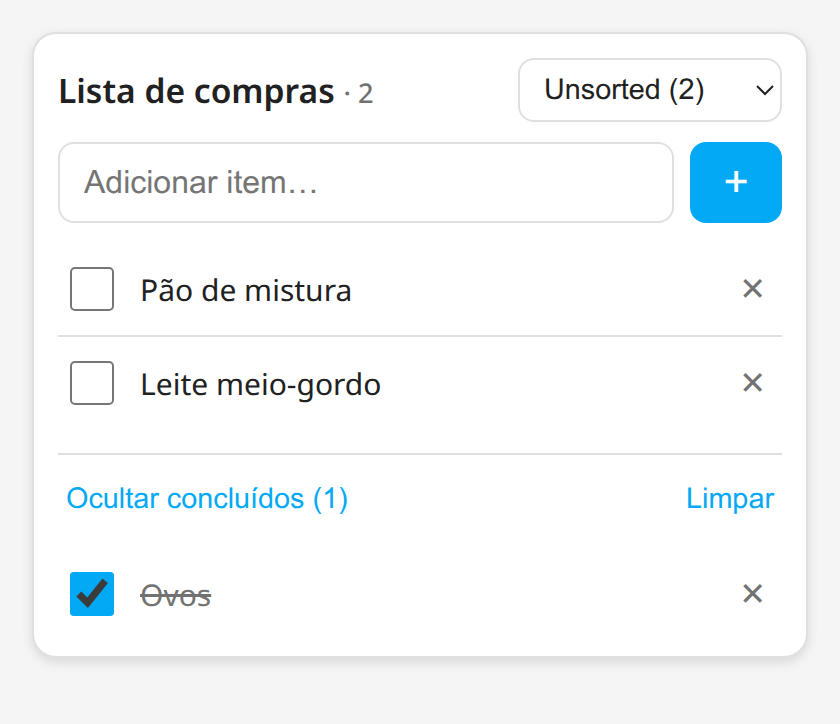
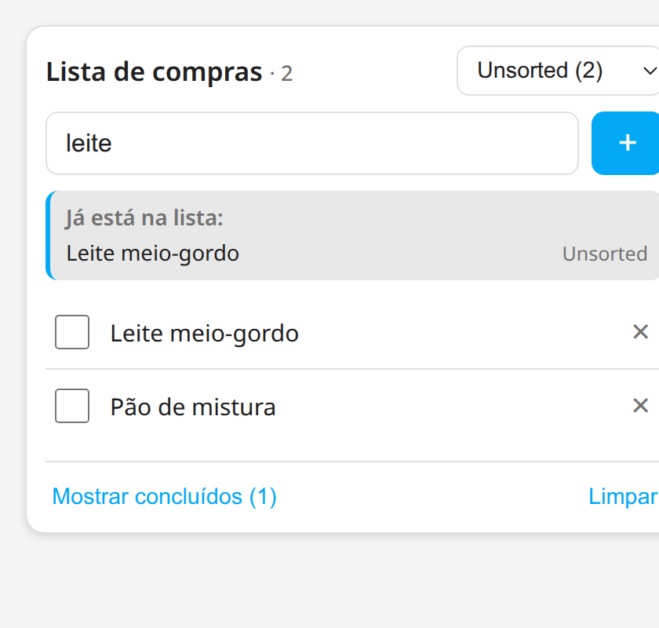
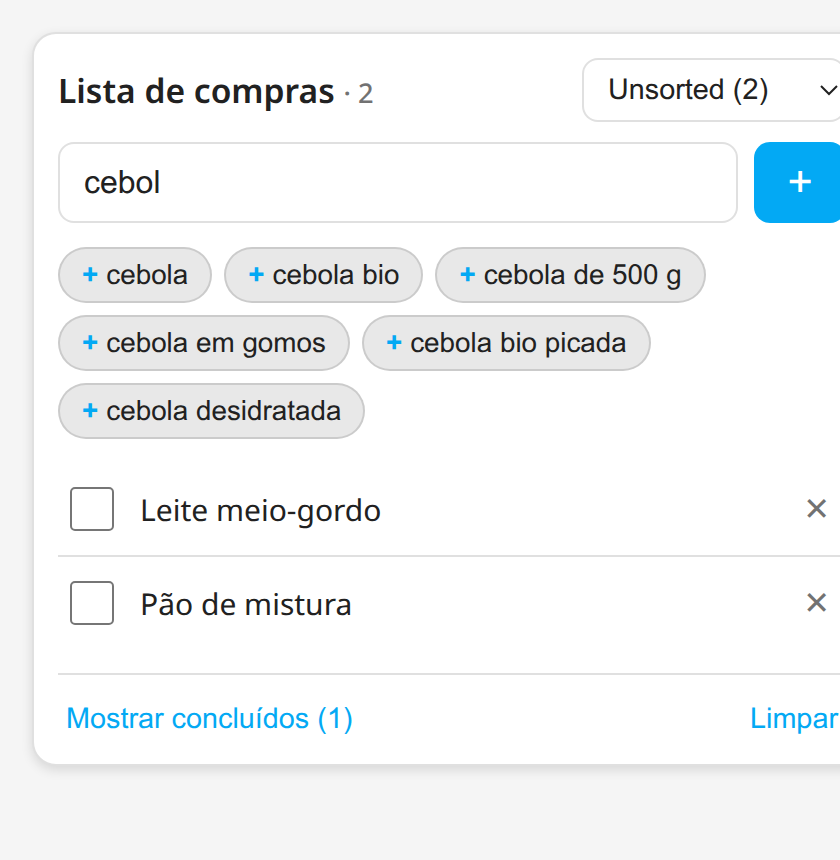

# Norish Shopping Card

🌍 **Português** · [English](README.md)



Um cartão Lovelace para Home Assistant que faz uma lista de compras estilo
**Bring!**, alimentada pelo Norish através da integração
[hass-norish](https://github.com/Caps3n/hass-norish).

Só texto, sem imagens. O cartão **não fala com a API do Norish** — lê e escreve
as entidades to-do que a integração já expõe (uma por loja) e deixa a chave da
API onde está: no servidor.

📖 **Explicação detalhada de como funciona** (em português, com demo ao vivo e
sem Home Assistant): [`docs/como-funciona.html`](docs/como-funciona.html)

## Funcionalidades



- **Seletor de loja** no cabeçalho: `Unsorted` + uma lista por loja
  (Lidl, Mercadona, Continente, Auchan, …), cada uma com a contagem de itens
  ativos.
- **Adicionar item** — escreve e prime Enter (ou o botão `+`).
- **Marcar / desmarcar feita** — checkbox; os itens feitos passam para uma
  secção recolhível.
- **Editar** — toca no texto do item, altera e prime Enter (Escape cancela).
- **Apagar item** — botão `✕`.
- **Limpar concluídos** — botão na barra inferior.
- **Aviso de duplicados** — enquanto escreves, o cartão mostra o que já está
  na lista (em qualquer loja) e, se configurares, o que já tens na despensa do
  Norish. É um aviso, não um bloqueio: podes sempre adicionar.
- Atualização em tempo real por subscrição websocket.
- **Eventos opcionais** (`fire_events`) para automatizações — ver
  [Automações](#automações-sugestões).

## Requisitos

- Home Assistant 2024.11 ou superior.
- A integração [hass-norish](https://github.com/Caps3n/hass-norish) instalada e
  a funcionar (é ela que cria as entidades `todo.norish_*`).

## Instalação (HACS)

1. HACS → canto superior direito (⋮) → **Custom repositories**.
2. URL: `https://github.com/jdrdionisio/norish-shopping-card`,
   categoria **Dashboard** (Lovelace).
3. Instala o **Norish Shopping Card**.
4. Se o recurso não for adicionado automaticamente, vai a
   **Definições → Dashboards → Recursos** e adiciona:

   ```
   URL: /hacsfiles/norish-shopping-card/norish-shopping-card.js
   Tipo: Módulo JavaScript
   ```

5. Recarrega o browser (Ctrl+Shift+R).

### Instalação manual

Copia `norish-shopping-card.js` para `config/www/` e regista o recurso
`/local/norish-shopping-card.js` (tipo Módulo JavaScript).

## Utilização

```yaml
type: custom:norish-shopping-card
title: Lista de compras
```

O cartão descobre sozinho todas as entidades `todo.norish_*`. Para fixar as
listas e a ordem:

```yaml
type: custom:norish-shopping-card
title: Compras da semana
entities:
  - todo.norish_unsorted
  - todo.norish_mercadona
  - todo.norish_continente
```

### Opções

| Opção      | Tipo            | Por omissão          | Descrição |
|------------|-----------------|----------------------|-----------|
| `title`    | string          | `Lista de compras`   | Título do cartão. |
| `entities` | lista de ids    | (auto-descoberta)    | Lista explícita de entidades `todo.norish_*` e respetiva ordem. |
| `warn_duplicates` | bool     | `true`               | Avisar quando o texto escrito já corresponde a um item da lista. |
| `pantry_entity`   | entity id | (nenhuma)           | Sensor com a despensa do Norish; liga o aviso «já tens em casa». Ver `docs/pantry-opcional.yaml`. |
| `ingredients_url` | URL      | (descoberto)         | Ficheiro JSON com o catálogo de alimentos. Se não indicares nada, o cartão procura sozinho (ver abaixo). |
| `ingredients`     | lista    | (nenhuma)            | O mesmo catálogo, mas escrito no YAML — para listas curtas. |
| `suggestions`     | número   | `10`                 | Quantas sugestões mostrar (1 a 30). |
| `fire_events`     | bool     | `false`              | Anunciar cada ação como um evento HA, com o utilizador que a fez — para automatizações «quem adicionou o quê». Ver [Automações](#automações-sugestões). |

## Evitar criar itens duplicados

O cartão faz duas verificações enquanto escreves, por baixo do campo de
adicionar:

1. **Contra a lista atual** (sempre ativa). Percorre os itens de *todas* as
   lojas, não só da visível — um item noutra loja continua a ser um item que já
   está na lista. Distingue os que estão por comprar dos já comprados.
2. **Contra a despensa** (opcional). A despensa é a secção «o que temos em
   casa» do Norish, e é a forma de evitar comprar o que já existe no armário.

A comparação normaliza o texto antes de o comparar: ignora maiúsculas e
acentos, descarta a quantidade e a unidade do início (`2 kg batatas` e
`batatas` são a mesma coisa), e tolera singular/plural (`ovo` encontra `Ovos`).
Nomes inventados não dão falso positivo — `leitinho` não corresponde a `Leite
meio-gordo`.

Como a despensa não está exposta ao Home Assistant, o ponto 2 precisa de um
sensor REST no teu `configuration.yaml`. Fica tudo explicado, com o YAML e o
URL já testados, em [`docs/pantry-opcional.yaml`](docs/pantry-opcional.yaml).

> Porque não vai buscar isto diretamente ao Norish: a API do Norish não envia
> cabeçalhos CORS (um pedido `OPTIONS` com origem do HA responde `204` sem
> nenhum `Access-Control-*`), e a chave da API teria de ficar visível no
> JavaScript do cartão. Os dados têm de entrar pelo servidor.

## Sugestões de alimentos (o catálogo do Norish)



Ao escrever, além dos avisos, o cartão mostra os alimentos que o Norish conhece
a começar por aquele texto — e **tocar num deles adiciona-o**. Não é preciso
acertar no nome exato, e nada é bloqueado: o campo continua a aceitar qualquer
texto novo.

O catálogo é a lista de alimentos que o Norish usa para reconhecer o que se
escreve (a taxonomia do Open Food Facts, com os nomes em português). Ele não
está exposto ao Home Assistant, por isso tem de ser materializado num ficheiro
que o HA sirva **na mesma origem** — e aí o cartão lê-o sem CORS e sem chave.

### Descobre sozinho

**Não precisas de configurar nada.** Sem `ingredients_url`, o cartão procura por
esta ordem, e usa o primeiro que encontrar:

1. `/local/norish-ingredients.json` — o catálogo completo, se o puseres no
   `config/www` do Home Assistant (é o sítio habitual);
2. `ingredientes-comuns.json` — uma lista de **509 alimentos de mercearia em
   português**, que vem no repositório e por isso é instalada com o cartão
   dentro de `/config/www/community/norish-shopping-card/`.

Falhas na descoberta automática são silenciosas: o cartão funciona, apenas sem
sugestões. Só uma `ingredients_url` escrita à mão é que mostra erro — para não
te deixar com um 404 invisível.

Ou seja: instalas o cartão pelo HACS e as sugestões já funcionam. E se quiseres
o catálogo completo do Norish (10 000 nomes em vez de 509), põe o ficheiro em
`config/www/norish-ingredients.json` e não mudes mais nada.

### Como obter o ficheiro

**Se já tens um export do Norish** (`{source, ingredients:[…]}`, com os aliases
em várias línguas), converte-o:

```bash
scripts/norish-catalogue-dump.py \
  --from-export norish-ingredients-2026-11-07.json \
  --out norish-ingredients.json
```

Um export real de 6214 alimentos com 71 516 aliases passou de **5,4 MB para
202 KB** (10 126 nomes), descartando as outras línguas e as descrições de
preparação («alho descascado e cortado em rodelas finas»), que não são coisas
que se compram.

**Também podes usar o export tal como está**, sem converter: o cartão lê-o
igualmente e extrai ~10 300 nomes. Custa 150 ms a carregar em vez de 30 ms, e as
sugestões trazem algumas variantes de preparação a mais — por isso a conversão
vale a pena, mas não é obrigatória se o que te trava for o passo extra.

**Se não tens export**, o mesmo script vai buscá-lo à API (retomável, e respeita
o limite de 500 pedidos/hora da chave — pára e continua mais tarde):

```bash
scripts/norish-catalogue-dump.py --status          # quanto falta?
scripts/norish-catalogue-dump.py --max-calls 400   # uma passagem
```

### Como instalar um catálogo completo (opcional)

Basta copiar o ficheiro para a pasta `www` do Home Assistant — o cartão
encontra-o sozinho, sem configuração:

```bash
cp norish-ingredients.json /config/www/
```

Se preferires outro sítio, indica-o:

```yaml
type: custom:norish-shopping-card
title: Lista de compras
ingredients_url: /local/norish-ingredients.json
suggestions: 16
```

`/local/` é a pasta `config/www` do Home Assistant, servida na mesma origem do
dashboard. Para listas curtas, podes escrever o catálogo no próprio YAML com
`ingredients: ["cebola", "alho", …]`.

### Formatos aceites

O cartão aceita qualquer destas formas, sem configuração:

```json
["cebola", "alho", "manteiga"]
```
```json
[{"name": "onion", "localeNames": {"pt": "cebola"}}]
```
```json
{"source": "…", "ingredients": [{"name": "onion", "aliases": [{"text": "cebola", "locale": "pt"}]}]}
```

Dos objetos usa o nome português, o inglês e os aliases em português, inglês ou
sem língua indicada.

> **Nota de licença:** o catálogo vem da taxonomia de ingredientes do Open Food
> Facts, distribuída sob **ODbL**. Por isso é que ele **não** vive neste
> repositório: é gerado localmente e fica do lado do Home Assistant. Se o
> redistribuíres, mantém a atribuição e a licença.

## Automações (sugestões)

Os triggers nativos do Home Assistant para listas to-do (`todo.item_added`,
`todo.item_removed`, `todo.item_completed`) dizem-te **que** itens mudaram, mas
não **quem** os mudou: os dados de disparo não trazem o contexto do utilizador
(é uma limitação do core, não da integração). O cartão, esse, corre no browser
com o `hass` do utilizador autenticado, por isso sabe exatamente quem é — e é
isso que `fire_events` expõe.

```yaml
type: custom:norish-shopping-card
title: Lista de compras
fire_events: true
```

Evento `norish_shopping_card_changed`, disparado **depois** de a ação ter
corrido bem:

| Campo       | Significado |
|-------------|-------------|
| `action`    | `added`, `removed`, `completed`, `reopened` ou `renamed`. |
| `user_id`, `user_name` | Quem fez a ação. |
| `entity_id`, `store` | A entidade `todo.norish_*` e o nome da loja. |
| `item`, `uid` | O item (texto e uid), quando é um só. |
| `items`, `uids` | Listas — usadas pelo «Limpar concluídos», que remove vários de uma vez. |
| `previous`  | No `renamed`, o texto anterior. |

O evento herda também o contexto do pedido, por isso
`trigger.event.context.user_id` fica preenchido — útil se preferires filtrar por
`context:`.

> **Requer administrador.** O Home Assistant só deixa *disparar* eventos a contas
> com permissões de administrador (tanto o comando WebSocket `fire_event` como
> `POST /api/events`). Se quem usa o cartão não for admin, o evento é
> simplesmente ignorado (fica um aviso na consola do browser) e o cartão
> continua a funcionar.
>
> **Só o cartão é que fala.** Itens adicionados ou removidos noutro sítio — na
> app Norish, ou noutro painel do HA — chegam ao HA por polling e não têm
> utilizador a quem atribuir. Para esses casos usa os triggers `todo.*` (dizem o
> quê, não quem).

### Sugestão 1 — avisar a cada alteração

O mais simples: uma notificação por ação.

```yaml
alias: Norish - item adicionado por
triggers:
  - trigger: event
    event_type: norish_shopping_card_changed
conditions:
  - condition: template
    value_template: "{{ trigger.event.data['action'] == 'added' }}"
actions:
  - action: notify.notify
    data:
      message: >-
        {{ trigger.event.data['user_name'] }} adicionou
        "{{ trigger.event.data['item'] }}" a {{ trigger.event.data['store'] }}.
```

Com várias alterações seguidas, isto são várias notificações. Se for esse o
problema, usa a sugestão 2.

### Sugestão 2 — um resumo, agrupado por pessoa, após a última alteração

É o que a maior parte das pessoas quer: **uma** notificação, depois de a lista
acalmar, a dizer o que mudou e por quem — e quem mexeu não é avisado. As
alterações da mesma pessoa são agrupadas:

```
Beatriz: +leite, ovos; Beatriz: −sal, pimenta; João: +chocolate, barritas
```

Precisa de duas peças:

1. o cartão com `fire_events: true`;
2. um auxiliar de texto chamado **Norish pendentes** (Definições → Dispositivos
   e serviços → Auxiliares → Criar auxiliar → Texto), com comprimento máximo
   **255** — fica `input_text.norish_pendentes`.

Como funciona: cada evento é guardado numa forma compacta (`João|+|chocolate`)
num auxiliar, e um `delay` reiniciado a cada evento adia o envio até haver
silêncio. No fim, as entradas são agrupadas por pessoa e por sinal.

```yaml
alias: Norish - resumo de alterações
mode: restart
max_exceeded: silent
triggers:
  - trigger: event
    event_type: norish_shopping_card_changed
variables:
  # Nome de utilizador do Home Assistant -> serviço de notificação.
  quem:
    "João": notify.mobile_app_poco
    "Beatriz": notify.mobile_app_pocobeatriz
  # Minutos de silêncio antes de enviar o resumo.
  silencio: 1
  # Quantas entradas guardar enquanto se acumula (o auxiliar tem 255 caracteres).
  max_entradas: 12
conditions: []
actions:
  # 1) Entrada compacta: autor|sinal|item.
  - variables:
      entrada: >-
        {{ [trigger.event.data['user_name'], {'added':'+','removed':'−','completed':'✓','reopened':'↺','renamed':'→'}.get(trigger.event.data['action'],'?'), trigger.event.data['item'] or (trigger.event.data['items'] | join(', '))] | join('|') }}
  # 2) Acrescenta a entrada ao acumulador.
  - action: input_text.set_value
    target:
      entity_id: input_text.norish_pendentes
    data:
      value: >-
        {{ (((states('input_text.norish_pendentes').split('; ') | select | list) + [entrada])[-max_entradas:] | join('; '))[-240:] }}
  # 3) Só avança quando houver silêncio: cada evento reinicia esta espera.
  - delay:
      minutes: "{{ silencio }}"
  # 4) Agrupa por pessoa e sinal.
  - variables:
      resumo: "{{ states('input_text.norish_pendentes') }}"
      grupos: >-
        
        
        
        
        
        
        
        
        
        
        
        
        {{ o.l | join('; ') }}
      intervenientes: >-
        {{ resumo.split('; ') | select | map('regex_replace', '[|].*', '') | unique | list }}
      avisar: >-
        {{ quem.items() | rejectattr('0', 'in', intervenientes) | map(attribute='1') | list }}
  # 5) Uma notificação por destinatário (quem alterou não é avisado).
  - if:
      - condition: template
        value_template: "{{ grupos | length > 0 and avisar | length > 0 }}"
    then:
      - repeat:
          for_each: "{{ avisar }}"
          sequence:
            - action: "{{ repeat.item }}"
              data:
                title: Lista de compras
                message: "{{ grupos }}"
      # 6) Limpa para a próxima rajada.
      - action: input_text.set_value
        target:
          entity_id: input_text.norish_pendentes
        data:
          value: ""
```

Notas da receita:

- **`silencio` é o botão que interessa.** O envio é sempre N minutos depois da
  última alteração. Não há forma de garantir «exatamente uma por sessão» sem um
  sinal de fim de sessão; se a lista for editada com pausas maiores que
  `silencio`, saem mais do que uma notificação.
- **`max_entradas` existe por causa do limite de 255 caracteres** do auxiliar.
  Com as entradas compactas cabem cerca de 15 alterações; o `[-240:]` é a
  segunda rede de segurança.
- **O texto do evento é lido por subscrito** (`trigger.event.data['items']`), de
  propósito: `trigger.event.data.items` devolveria o *método* `items` do
  dicionário, não o valor da chave. O mesmo vale para `keys`, `values`, `get`,
  `update`, `copy` e `pop`.
- Os templates usam o filtro `format` e o filtro `join` em vez do operador de
  concatenação `~`, para não haver caracteres que se possam escapar ao colar.
- Um `delay` **não sobrevive a um reinício do Home Assistant** a meio: o resumo
  fica no auxiliar e sai no evento seguinte.
- Se um nome de item contiver `|` ou `; `, o agrupamento desse item sai torto.
  Para nomes de compras é aceitável.

### Sugestão 3 — aviso genérico, sem auxiliar nenhum

Se o que queres é apenas «alguém mexeu na lista», isto dispensa o auxiliar e o
acumulador — e com eles o limite de caracteres. Perde o detalhe, e como não
guarda memória das alterações só consegue excluir o autor do *último* evento.

```yaml
alias: Norish - aviso de alterações
mode: restart
max_exceeded: silent
triggers:
  - trigger: event
    event_type: norish_shopping_card_changed
variables:
  quem:
    "João": notify.mobile_app_poco
    "Beatriz": notify.mobile_app_pocobeatriz
  silencio: 1
conditions: []
actions:
  - delay:
      minutes: "{{ silencio }}"
  - variables:
      autor: "{{ trigger.event.data['user_name'] }}"
      avisar: >-
        {{ quem.items() | rejectattr('0', 'eq', autor) | map(attribute='1') | list }}
  - repeat:
      for_each: "{{ avisar }}"
      sequence:
        - action: "{{ repeat.item }}"
          data:
            title: Lista de compras
            message: "Houve alterações na lista de compras."
```

## Notas

- Criar ou gerir **lojas** não é possível a partir do cartão: as lojas são
  geridas na app Norish e a integração apenas as descobre. O cartão faz CRUD de
  **itens**.
- O Norish reescreve o texto do item ao gravar (quantidade/unidade são
  interpretadas pelo servidor), por isso um item pode aparecer ligeiramente
  diferente depois de gravado — por exemplo `2 kg farinha`.
- Reordenar arrastando não está disponível: a entidade to-do do Norish não
  expõe essa capacidade.

## Desenvolvimento

A imagem do README é gerada a partir de `docs/preview.html`, que carrega o
cartão com um `hass` simulado:

```
cd docs
google-chrome --headless=new --window-size=420,362 --force-device-scale-factor=2 \
  --screenshot=card.png "file://$PWD/preview.html"
```

## Licença

Apache License 2.0 — ver [LICENSE](LICENSE) e [NOTICE](NOTICE).

Todos os ficheiros deste repositório (o cartão, o script, a lista de alimentos
`ingredientes-comuns.json` e a documentação) estão sob esta licença.

**Não** faz parte do repositório, nem está sob esta licença, qualquer catálogo de
alimentos que gerares a partir da tua instância do Norish: esses dados vêm da
taxonomia do Open Food Facts e ficam sob a **ODbL** onde forem redistribuídos.
Por isso é que o catálogo completo é gerado localmente e vive do lado do Home
Assistant.
